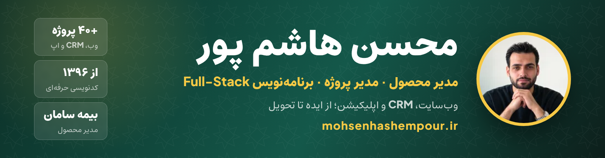

## سلام، من محسن هاشم پورم 👋

**مدیر محصول در بیمه سامان؛ پیش از مدیریت، خودم ساخته‌ام.** از ۱۳۹۶ کد می‌نویسم و بیش از ۴۰ وب‌سایت، CRM و اپلیکیشن را از ایده تا تحویل پیش برده‌ام. همین پیشینه‌ی Full-Stack باعث می‌شود با تیم فنی هم‌زبان باشم، برآورد واقعی بدهم و Scope را از اول روشن کنم.

> *English:* Product manager, project manager and full-stack developer based in Iran. I take web, CRM and mobile products from idea to delivery.

  
  
  
  

---

### چه کار می‌کنم

| | |
|---|---|
| 🎯 **محصول** | کشف مسئله، اولویت‌بندی، نقشه‌ی راه و تصمیم‌گیری با داده |
| 🗂️ **پروژه** | Scope روشن، زمان‌بندی، کنترل تغییرات و تحویل مرحله‌ای؛ هدایت تیم‌های ۵ تا ۱۲ نفره |
| 🛠️ **ساخت** | وب‌سایت، اپلیکیشن و CRM اختصاصی؛ از طراحی تا انتشار و نگهداری |

**پروژه‌ی وب، اپ یا CRM دارید؟** با یک گفتگوی ۳۰ دقیقه‌ای Scope را روشن می‌کنیم: [مشاوره و شروع پروژه ←](https://mohsenhashempour.ir/contact)

---

### پشته‌ی فنی

  
  
  
  
  
  
  
  
  
  
  
  

---

### کارهای شاخص

- **بیمه سامان:** مالکیت محصول دیجیتال، وب‌سایت اصلی و CRMهای داخلی؛ یک نقشه‌ی راه واحد برای خواسته‌های بازاریابی، فنی، سئو و محتوا
- **کمپین پیش‌بینی جام جهانی:** از ایده تا اجرا، با سیستم امتیازدهی و پنل کاربری و تاریخ تحویل ثابت
- **HDM:** تحویل پروژه‌های وب و نرم‌افزار با مدیریت Scope، منابع و بودجه
- **تیغ‌یار:** اسکریپت نوبت‌دهی و مدیریت آرایشگاه (پنل موبایلی، رزرو آنلاین، باشگاه مشتریان)

[همه‌ی کارنامه ←](https://mohsenhashempour.ir/projects)

---

### تازه‌ترین نوشته‌ها

<!-- BLOG-POST-LIST:START -->- [چرا «بیشتر ویژگی» به «محصول بهتر» نمی‌رسد؟ نشانه‌های محصولِ پرکار و کم‌اثر](https://mohsenhashempour.ir/insights/more-features-does-not-mean-better-product) — 2026/11/28- [از کجا بفهمیم تیم فنی زیر فشار است؟ نشانه‌های زودهنگام برای مدیر محصول و صاحب کسب‌وکار](https://mohsenhashempour.ir/insights/early-signs-technical-team-under-pressure) — 2026/11/27- [مقاومت در برابر تغییر؟ شاید مشکل از طراحی تغییر است](https://mohsenhashempour.ir/insights/change-management-resistance-or-poor-design) — 2026/11/26- [چرا پروژه‌های تحول دیجیتال در سازمان‌های سنتی بیشتر به فرایند گیر می‌کنند تا فناوری؟](https://mohsenhashempour.ir/insights/why-digital-transformation-stalls-on-process-not-technology) — 2026/11/25- [وقتی دو واحد سازمان دو اولویت متضاد دارند: چارچوبی برای حل تعارض در محصول](https://mohsenhashempour.ir/insights/resolving-conflicting-priorities-product-stakeholders) — 2026/11/24<!-- BLOG-POST-LIST:END -->

[همه‌ی نوشته‌ها ←](https://mohsenhashempour.ir/insights) · [ابزارها و واژه‌نامه‌ی رایگان ←](https://mohsenhashempour.ir/tools)

---

### ارتباط

  
  
  
  
  

این پروفایل با پروفایل رسمی من در [mohsenhashempour.ir](https://mohsenhashempour.ir) هماهنگ است.

